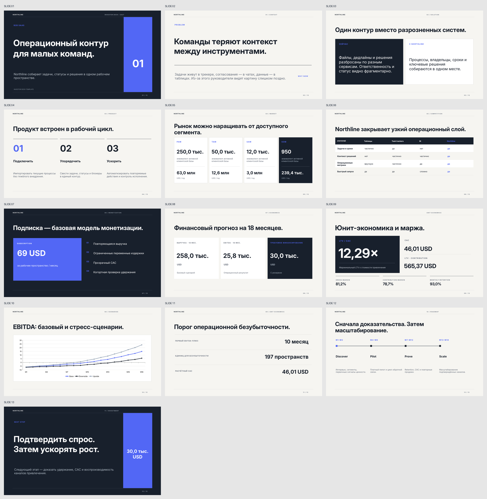

# Investment Skillkit — From Startup Idea to Pitch

**Agent Skills for startup founders to pressure-test an idea, identify the riskiest assumptions and build a clear, evidence-backed pitch.** Works with Codex, Claude Code and Cursor.

Start with a rough idea. Clarify who has the problem, why they would pay and how the business could work. Research the market and competitors, separate evidence from assumptions, and decide what to validate next. When the story is ready, turn it into an editable PowerPoint deck with numbers grounded in the same financial model.

## Who it's for

- **First-time founders** turning an idea into a focused problem, customer and value proposition.
- **Early-stage teams** checking demand signals, pricing and unit economics before committing to a build.
- **Founders preparing a pitch** for a cofounder, accelerator or investor who need a coherent story and defensible numbers.

## From idea to a testable pitch

1. **Frame the idea:** define the customer, problem, proposed solution and business model.
2. **Challenge the assumptions:** examine demand signals, alternatives, competitors and pricing; flag gaps and counterevidence.
3. **Choose what to test next:** prioritize the assumptions that could change the decision and outline practical tests with success criteria.
4. **Check the economics:** model revenue, costs, cash needs and scenarios when the inputs are ready.
5. **Build the pitch:** connect the problem, solution, market, business model and funding needs in an editable deck.

Use the initial research to narrow your next experiment. Desk research and forecasts do not validate customer demand on their own: interviews, landing-page tests, pilots or actual sales still need to happen. Financial modeling can follow once you have enough evidence to make the inputs useful.



> The demo is **fully fictional**. Its tax rates, market sizes, competitor matrix and forecast are not facts or investment advice.

## What's inside

| Skill | Responsibility | Output |
|---|---|---|
| `business-analyst` | Pressure-test the idea, research the market and competitors, surface critical assumptions, and model pricing, unit economics and funding needs | Evidence register, analytical report, `monthly.json`, `metrics.json`, optional formula-driven `.xlsx` |
| `investor-slides` | Turn the business case into a clear pitch with traceable numbers, editable slide layouts and visual QA | Editable `.pptx`, manifest and optional PDF |

**Standard** is the default. **Deep** expands research on material uncertainty only. Instructions are loaded progressively from compact `references/*.md` files. Core numeric computations use Python rather than conversational arithmetic.

## Quick install

From your target project, run:

```bash
npx skills add euphoo-01/startup_pitch_skills
```

Choose the skills and agents in the interactive installer. Installation is project-local by default; add `-g` for a user-wide installation. The Skills CLI requires Node.js 22.20 or later; see the [CLI documentation](https://github.com/vercel-labs/skills).

To install only one skill:

```bash
npx skills add euphoo-01/startup_pitch_skills --skill business-analyst
npx skills add euphoo-01/startup_pitch_skills --skill investor-slides
```

To list available skills without installing them:

```bash
npx skills add euphoo-01/startup_pitch_skills --list
```

Alternatively, clone this repository and use the bundled Python installer:

```bash
git clone https://github.com/euphoo-01/startup_pitch_skills.git
cd startup_pitch_skills
python install.py --target all --project /path/to/your/target-project

# Optional: use for the current directory only
python install.py --target codex --project .
```

Python installer paths: Codex/Cursor `.agents/skills/`; Claude Code `.claude/skills/`. For user-wide installs: `--scope user`. If replacing existing skill folders: `--force`.

## Requirements

- **Python 3.10+** for deterministic finance and audits. Financial calculation itself uses only the standard library.
- **Node.js 18+** and **PptxGenJS** for editable slides: `npm install`.
- **artifact_tool** for formula-driven Excel export (optional; available in compatible artifact environments).
- **LibreOffice** to export a PDF preview (optional).

## Demo — one command

```bash
npm install
python scripts/build_demo.py
```

This generates the fictional Northline case in `demo/`. If `artifact_tool` is unavailable, it skips Excel but still builds and audits the PPTX.

For environments without LibreOffice or artifact_tool:

```bash
python scripts/build_demo.py --no-excel --no-pdf
```

Or run the individual steps:

```bash
python skills/business-analyst/scripts/calculate.py examples/sample_b2b.json --out demo
python skills/business-analyst/scripts/sizing.py examples/sample_b2b.json --out demo/market.json
node skills/investor-slides/scripts/generate_deck.cjs examples/sample_deck.json \
  --metrics demo/metrics.json --monthly demo/monthly.json --market demo/market.json \
  --out demo/investor_pitch.pptx --manifest demo/deck_manifest.json
python skills/investor-slides/scripts/audit_deck.py demo/investor_pitch.pptx \
  --metrics demo/metrics.json --manifest demo/deck_manifest.json --monthly demo/monthly.json --market demo/market.json
```

## Ask your AI agent

Prompts below are in English, but you can use your preferred language and ask for the analysis and slides in that language.

**Start with an idea:**

> Use `business-analyst` in Standard mode. My idea: [describe your idea]. Help me clarify the target customer, problem, value proposition and revenue model. Research available demand signals and the closest competitors. Separate facts from hypotheses, identify the riskiest assumptions, and suggest quick tests using interviews, a landing page or a pilot, including what to measure and what would count as success. Start with essential questions and an initial assessment; confirm the key assumptions with me before building a detailed financial model. Do not invent demand, interviews or sources.

**Check the economics once the inputs are ready:**

> Use `business-analyst` in Standard mode: clarify critical inputs, research the market and competitors, estimate PAM/TAM/SAM/SOM in customers and annual revenue, and justify pricing, conversion, CAC and retention assumptions. Build a P&L, calculate EBITDA and taxes, and forecast monthly cash flow. Determine break-even volume, payback, capital requirements and funding tranches. Confirm the assumptions with me before the final calculations. Do not invent sources.

**Turn the idea and evidence into a pitch:**

> Use `investor-slides` with the approved narrative and calculated JSON outputs. Create an 8–12 slide pitch for [a cofounder / an accelerator / an investor]: problem, customer, solution, market, competitors, business model, available evidence, economics and next steps. Clearly label untested hypotheses and do not invent traction. Build a PPTX with editable objects in a neutral, modern style. Bind every number to model outputs or sources; review rendered slides and check for overflow. Use the selected palette rather than the demo project's branding.

## Slide styles

Preset themes: `editorial-blue` (**default**), `graphite-lime`, `warm-coral`. Choose by editing `examples/sample_deck.json` → `theme.preset`. You can override `background` and `ink` via `paper`, `ink`, `accent`, `dark`, `muted`, etc. or set user brand colors. **None is tied to a specific startup.**

Native slide types: `cover`, `statement`, `split`, `steps`, `market`, `matrix`, `pricing`, `bullets`, `numbers`, `unit-economics`, `chart`, `economics`, `timeline`, `image`, `closing`. For a single subscription stream, the generator automatically inserts a unit-economics spread showing **LTV/CAC, CAC, contribution LTV, Gross Margin, Contribution Margin, and retention**. Multiple streams require an explicit stream selection.

Do not use these layouts as a fixed demo script: select only what the real narrative requires. `investor-slides/references/design.md` and `visual-qa.md` are lazy-loaded, not copied into the business skill.

## Reliability and boundaries

- Excel, PPTX, PDF and the text report must be based on **the same model**, not separately typed totals.
- Market levels must share compatible audience definitions, geography, period and monetization assumptions; SOM also needs a bottom-up attainable sales plan.
- Revenue LTV ≠ contribution LTV. Project payback ≠ positive EBITDA ≠ investor payback.
- Monthly cash-flow and funding tranches (not EBITDA alone) determine investment timing.
- **Taxes are not automatically verified**: check jurisdiction, applicable regime, rate, effective date and payment calendar. An unverified tax source blocks an investment-ready signoff.
- The numeric engine is a driver-based v1 for units, subscriptions and freemium; it is not a universal accounting or tax engine. See [limitations](docs/LIMITATIONS.md).
- `audit_deck.py` checks bound KPI text and native objects, not full semantic meaning or visual quality. A real render review is mandatory.

## Repository map

```text
skills/
  business-analyst/
    SKILL.md  references/  schemas/  scripts/
  investor-slides/
    SKILL.md  references/  scripts/
examples/          # Synthetic, non-validated business inputs and slide plans
demo/              # Editable example deck, PDF, financial results, preview
scripts/           # Reproducible demo builder
tests/             # Unit, model parity, PPTX metric bindings
.github/workflows/ # CI tests
```

See [Quickstart RU](QUICKSTART_RU.md), [Architecture](docs/ARCHITECTURE.md), [Data contract](docs/DATA_CONTRACT.md), and [Design rules](docs/DESIGN_SYSTEM.md).

## License and attribution

The code and original skill instructions in this repository are MIT licensed. Visual design checks were informed by broad ideas from [Unslop](https://github.com/heydamir/unslop) and [OpenDesign](https://github.com/nexu-io/open-design); this repo **does not copy** their instruction files or bundle their assets. It uses [PptxGenJS](https://github.com/gitbrent/PptxGenJS) as an external dependency under its own license.
